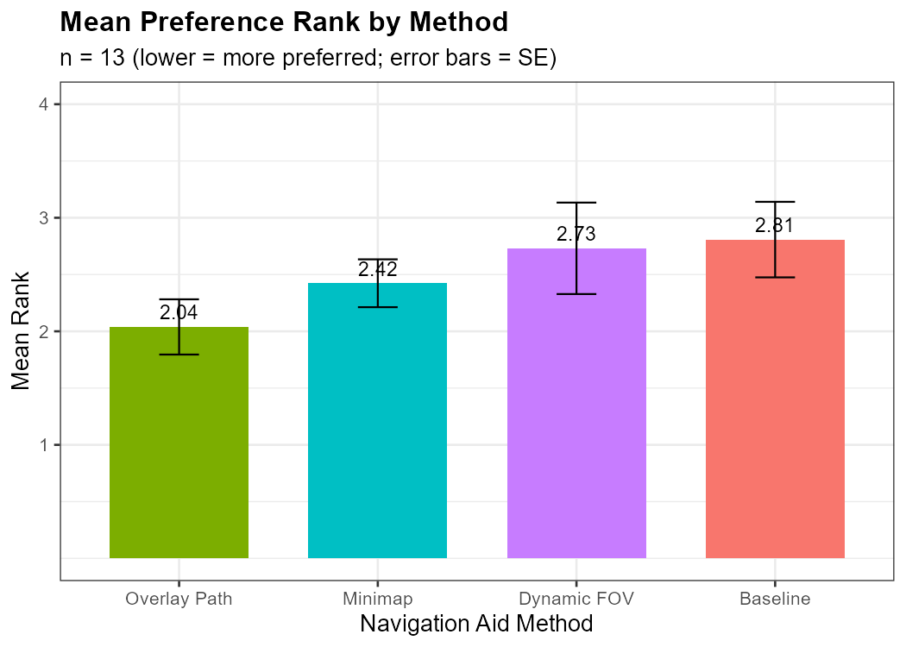
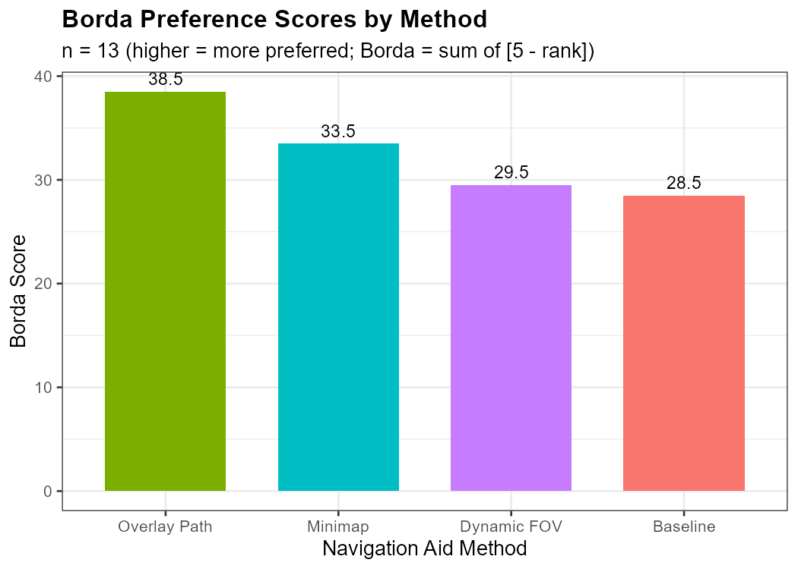
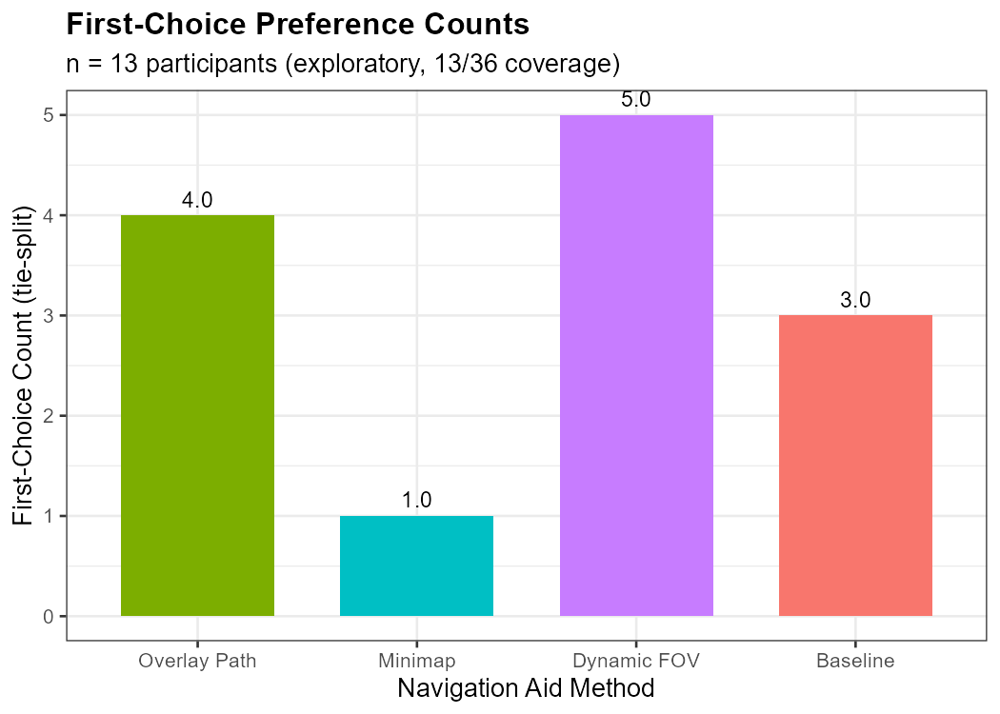
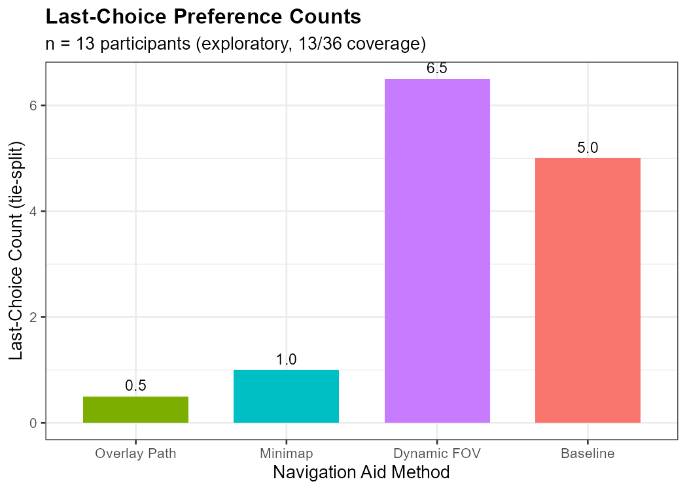

# Đánh Giá Kết Quả Preference Ranking (Thăm Dò)

**Phân tích:** Preference ranking — xếp hạng chủ quan của người tham gia  
**Thiết kế:** Within-subject, 4 điều kiện, complete ranking (1–4)  
**N:** 13 / 36 người tham gia (36.1% coverage)  
**Framing:** EXPLORATORY — kết quả mang tính mô tả, không xác nhận (confirmatory)  
**Thống kê:** Mean/median rank, Borda score
**Tool:** R 4.5.1, tidyverse 2.0.0, base R binom.test

---

## 1. Giới Hạn Quan Trọng

- Chỉ 13/36 (36.1%) người tham gia cung cấp preference ranking

---

## 2. Thống Kê Mô Tả

### 2.1 Bảng Tổng Hợp (sắp xếp theo Mean Rank, thấp = ưa thích hơn)

| Phương pháp  | Mean Rank | Median | SD    | Borda Score | First Choice | First % | Last Choice | Last % |
| ------------ | --------- | ------ | ----- | ----------- | ------------ | ------- | ----------- | ------ |
| Overlay Path | 2.038     | 2.0    | 0.877 | 38.5        | 4.0          | 30.8%   | 0.5         | 3.8%   |
| Minimap      | 2.423     | 2.0    | 0.760 | 33.5        | 1.0          | 7.7%    | 1.0         | 7.7%   |
| Dynamic FOV  | 2.731     | 3.5    | 1.452 | 29.5        | 5.0          | 38.5%   | 6.5         | 50.0%  |
| Baseline     | 2.808     | 3.0    | 1.200 | 28.5        | 3.0          | 23.1%   | 5.0         | 38.5%  |

*Ghi chú: First/Last choice count được chia đều khi có tie (ví dụ: nếu 2 phương pháp cùng rank 1, mỗi phương pháp nhận 0.5 first-choice).*

*Hình: Mean Preference Rank theo method (thấp = ưa thích hơn, error bars = SE).*

### 2.2 Nhận Xét Mô Tả

- **Overlay Path** có mean rank tốt nhất (2.038) và Borda score cao nhất (38.5). Hầu như không bao giờ bị xếp cuối (0.5 last-choice). Đây là phương pháp **ưa thích nhất một cách nhất quán (consistently preferred)**.

- **Minimap** xếp thứ 2 (mean = 2.423, Borda = 33.5). Ít khi được chọn đầu tiên (7.7%) nhưng cũng rất ít khi bị xếp cuối (7.7%). Đây là phương pháp **an toàn, ít gây tranh cãi (safe middle option)**.

- **Dynamic FOV** là phương pháp **phân cực nhất (most polarizing)**: có nhiều first-choice nhất (5, 38.5%) nhưng cũng nhiều last-choice nhất (6.5, 50%). SD cao nhất (1.452) xác nhận sự phân tán ý kiến.

- **Baseline** xếp cuối về mean rank (2.808) và Borda (28.5). Có một nhóm nhỏ ủng hộ (3 first-choice, 23.1%) nhưng phần lớn xếp thấp.

*Hình: Borda Preference Score theo method (cao = ưa thích hơn).*

*Hình: Số lần được chọn first-choice (tie-split). Dynamic FOV nhiều nhất nhưng cũng nhiều last-choice nhất — phân cực rõ.*

*Hình: Số lần bị xếp last-choice (tie-split). Dynamic FOV bị xếp cuối nhiều nhất (6.5/13), Overlay Path gần như không bao giờ bị xếp cuối (0.5/13).*

---

*Phân tích thực hiện bằng R 4.5.1 + tidyverse 2.0.0 + base R binom.test.*  
*Xem `preference_results.txt` cho full statistical output.*
